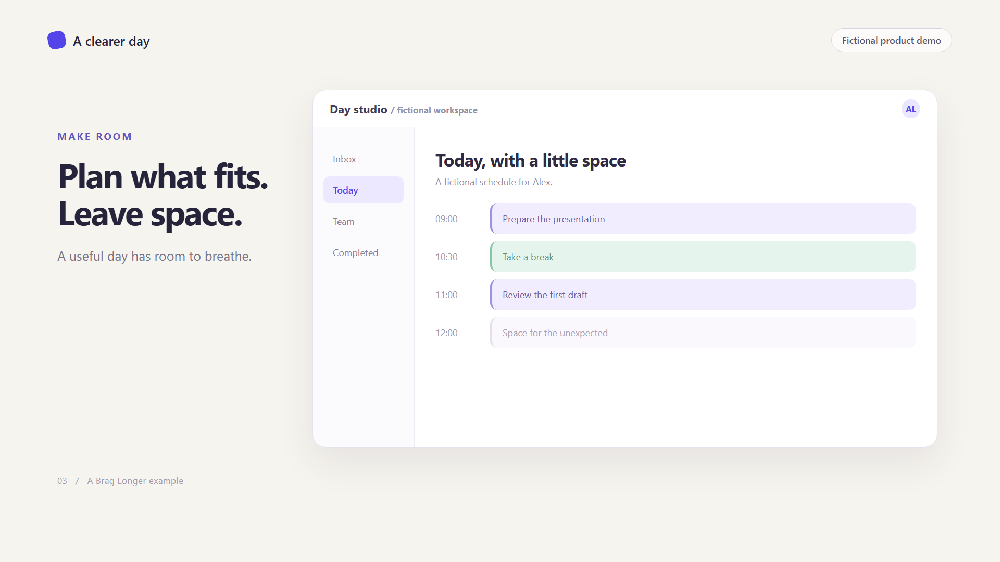

# A Clearer Day — three-minute example

[Watch or download the captioned 1080p film](https://github.com/mohitgargcanada-max/brag-longer/releases/download/demo-v1/A-Clearer-Day-v1-captioned.mp4)

[](https://github.com/mohitgargcanada-max/brag-longer/releases/download/demo-v1/A-Clearer-Day-v1-captioned.mp4)

**3:00 · 1920 × 1080 · 24 fps · English narration · Captions · Original procedural music**

A fictional studio owner, Alex, moves from scattered tasks to a clear daily plan.
This is a generic storytelling and rendering example, not a demonstration of a real
commercial app. All screens, people, tasks and scenarios were invented for this film.
The film carries a fictional-product label throughout and credits the original
inspiration in its closing card.

## What was used

- The repository's Brag Longer scaffold, narration, deterministic scene engine,
  browser-frame renderer, procedural music, mix and caption helpers.
- Six chapters, twelve scenes and a 416-word script approved by the maintainer.
- Kokoro `af_heart` at speed `1.0`; recorded speech was not sped up.
- Extra silence at chapter tails to reach exactly 180 seconds on the frame grid.
- An ivory, indigo and mint visual system with local system fonts; no stock imagery.
- Existing local tools and models. The production machine used system FFmpeg via
  a local compatibility adapter instead of downloading imageio-ffmpeg's bundle.
  The standard dependency installation documented in the repository works without
  that machine-specific adapter.

## Rebuild

Install the dependencies described in the root README. From the repository root:

```text
python -P scripts/scaffold.py examples/a-clearer-day/workspace A-Clearer-Day
```

Copy this folder's `video.json` to `workspace/video.json`, and `script/script.md` to
`workspace/script/script.md`. Place the separately obtained Kokoro model and voice
files in `workspace/tools/kokoro/`, or configure `kokoro_dir` in that workspace.
Install `playwright-core` so it is resolvable from the workspace and provide Chromium.

```text
python examples/a-clearer-day/build_example.py examples/a-clearer-day/workspace
python -P scripts/narrate.py examples/a-clearer-day/workspace
python examples/a-clearer-day/finish_timing.py examples/a-clearer-day/workspace
node scripts/render.mjs examples/a-clearer-day/workspace stills 1
node scripts/render.mjs examples/a-clearer-day/workspace video
python -P scripts/mix.py examples/a-clearer-day/workspace v1
```

Review every chapter's stills before rendering; the `stills 1` command above only
illustrates the command for chapter 1. Use a new version label for revisions. Run
`finish_timing.py` after each narration regeneration: narration regenerates its
timeline from source. If new speech exceeds 180 seconds, edit the script rather
than force the timing helper through its assertion.

This records a reproducible workflow, not a promise of byte-identical output across
different dependency versions, operating systems or system-font installations.

## Verification

The release was fully decoded and checked for duration, resolution, frame rate,
pixel format and BT.709 limited-range metadata. Encoded audio was compared with
the source mix across six windows. Local transcription checked the opening occurred
once and the story progressed through all chapters. See `verification.json` for
the measured results and released MP4 SHA-256, `transcript.txt` for the machine
transcript, and `captions.srt` for the authored captions.

## Credits

Customized and maintained by **Mohit Garg (ScaleQor)**. Inspired by **Shunit Haviv
Hakimi's [/brag and /brag-slim](https://github.com/latent-spaces/brag)**. Voice model:
[Kokoro by hexgrad](https://huggingface.co/hexgrad/Kokoro-82M), through
[kokoro-onnx](https://github.com/thewh1teagle/kokoro-onnx). Music is generated by the
included Brag Longer music helper. See the root `CREDITS.md`, `NOTICE.md` and
`LICENSE-STATUS.md`; this example does not assign a new license to the skill.
